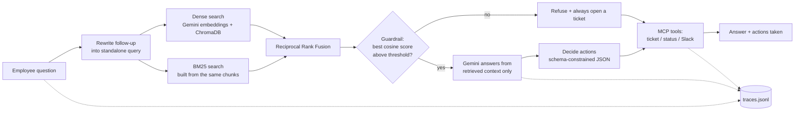

# IT Support Agent

[](https://github.com/Prathamesh0309/it-support-agent/actions/workflows/ci.yml)

An IT helpdesk assistant that answers from a knowledge base and takes action through MCP tools. The retrieval stack is written from scratch (chunking, BM25, rank fusion, a relevance guardrail), and every claim about quality is backed by an eval you can run.

## What's in it

| Area | What I built | Where |
| --- | --- | --- |
| **Custom retrieval** | BM25 from scratch, dense search over Gemini embeddings in ChromaDB, merged with Reciprocal Rank Fusion. Switch with `RETRIEVAL_MODE=dense\|bm25\|hybrid` | `rag/bm25.py`, `rag/fusion.py`, `phase1_rag.py` |
| **Chunking** | Section-aware chunking that keeps a problem and its fix together, plus a fixed-window baseline to measure it against | `rag/chunking.py` |
| **Guardrail** | If nothing retrieved is close enough (calibrated cosine threshold), the LLM is never called; the agent refuses and opens a ticket instead of guessing | `phase1_rag.is_relevant` |
| **Tool use** | FastMCP server with `create_ticket`, `check_ticket_status`, `notify_slack`; orchestrator uses schema-constrained JSON for decisions, with a deterministic override on top | `mcp_server.py`, `orchestrator.py` |
| **Evals** | Retrieval metrics (hit@k, MRR) separate from generation metrics (LLM-as-judge, different model from the generator); chunking and retrieval-mode ablations; regression gate in CI | `evals/`, `evaluate_rag.py` |
| **Observability** | One JSON trace per request with timed spans, token counts, retries, tool calls; a report CLI for latency percentiles, refusal and escalation rates | `observability.py`, `trace_report.py` |
| **Reliability** | Exponential backoff on 5xx and 429, safe fallbacks when the decision step fails | `config.generate` |
| **Tests / CI** | 49 offline tests (all model and tool calls mocked), GitHub Actions on every push, plus a manual live-eval workflow | `tests/`, `.github/workflows/` |

## Architecture



## Design decisions

**Chunking is measured, not assumed.** The knowledge base is written as self-contained sections, so splitting on those boundaries keeps a symptom and its fix in one chunk. A plain 500-character window cuts procedures mid-step. On the offline BM25 benchmark below, section chunking beats the fixed window on every question type.

**Hybrid retrieval, fused by rank.** Embeddings handle paraphrase ("my computer is sluggish" finds "Laptop is slow or freezing"); BM25 handles exact tokens (`MTU`, `ext. 4357`, `CorpGuest`). Their scores sit on different scales, so I merge by rank with RRF instead of normalising and weighting.

**The refusal guardrail stays on dense cosine similarity.** BM25 scores have no absolute scale, so they can't say "this is off-topic". The threshold (`MIN_RELEVANCE = 0.62`) was set in the gap between in-scope and out-of-scope similarity on the original, smaller knowledge base. The knowledge base has since grown, so confirm it with `python evaluate_rag.py --compare` (it reports out-of-scope refusals and wrongly refused in-scope questions) and re-calibrate if either is off.

**The judge is a different model from the generator**, so the system isn't grading its own answers. Retrieval is scored with no LLM at all: a hit means the retrieved text contains the fact needed to answer, which also makes it fair across chunking strategies.

**Tracing is built in, and private by default.** Query text is recorded only as a length and a short hash unless `TRACE_CONTENT=1`. A write failure never breaks a request.

## Results

Offline benchmark: BM25 only, top-3, 30 in-scope questions, no API key needed (`python -m evals.retrieval_eval --chunking both`). It also runs in CI as a regression gate.

| Chunking | Chunks | hit@3 | MRR | Direct | Paraphrase | Lexical gap |
| --- | --- | --- | --- | --- | --- | --- |
| **Section-aware** | 23 | **0.867** | **0.817** | 1.00 | 0.90 | 0.62 |
| Fixed 500-char window | 22 | 0.767 | 0.633 | 0.92 | 0.80 | 0.50 |

"Lexical gap" questions share almost no words with the answer ("my computer is really sluggish" vs "Laptop is slow or freezing"), which is where lexical search is weakest and dense search should help. Compare all three modes against your own index with:

```bash
python evaluate_rag.py --compare      # dense vs bm25 vs hybrid: hit@3, MRR, refusal behaviour
python evaluate_rag.py                # full run with the LLM judge: faithfulness, answer relevancy
```

An earlier run of the original 7-case set (dense retrieval only) scored 0.95 to 1.0 on the judged metrics.

**Limits, stated plainly:** the knowledge base (5 documents, 23 chunks) and the 34-question set are small and hand-written by me, so treat the numbers as a regression signal, not a benchmark. Evaluation is single-turn. The ticket and Slack backends are mocks.

## Observability

Every request writes one line to `traces/traces.jsonl`: total latency, a flat list of spans (`retrieve`, `llm.generate`, `embed`, `decide`, `tool.*`) with parent ids and durations, model name, prompt and output tokens, retry counts, and request-level flags (`answered_from_kb`, `escalated`).

```bash
python trace_report.py
```

reports request count, p50/p95 latency overall and per span, LLM calls per request, tokens per model, refusal rate, escalation rate and tool usage. Set `TRACING=0` to turn it off.

## Quick start

Requires Python 3.10+ and a Gemini API key.

```bash
git clone https://github.com/Prathamesh0309/it-support-agent
cd it-support-agent
python -m venv venv && source venv/bin/activate   # Windows: venv\Scripts\activate
pip install -r requirements.txt
echo "GEMINI_API_KEY=your_key_here" > .env

python phase1_ingest.py     # chunk, embed and index data/*.txt
python orchestrator.py      # the agent: retrieval + tool actions
```

| Setting | Default | Meaning |
| --- | --- | --- |
| `RETRIEVAL_MODE` | `hybrid` | `dense`, `bm25` or `hybrid` |
| `CHUNKING` | `section` | `section` or `fixed` (re-run `phase1_ingest.py` after changing) |
| `JUDGE_MODEL` | see `config.py` | Model used by the LLM judge |
| `TRACING` / `TRACE_FILE` / `TRACE_CONTENT` | `1` / `traces/traces.jsonl` / off | Tracing switch, location, and opt-in raw query text |

## Testing and evals

```bash
pip install -r requirements-dev.txt
pytest                                           # 49 offline tests, no API key
python -m evals.retrieval_eval --chunking both   # offline BM25 + chunking ablation
python evaluate_rag.py --compare                 # live: dense vs bm25 vs hybrid
python evaluate_rag.py --min-hit-rate 0.85 --min-faithfulness 0.9   # live gate: exit 1 if below
```

The `live-eval` GitHub Actions workflow runs the live evaluation on demand; add a `GEMINI_API_KEY` repository secret first.

## Project structure

| Path | Purpose |
| --- | --- |
| `rag/` | Chunking strategies, BM25, rank fusion. No API calls |
| `phase1_ingest.py` | Loads `data/*.txt`, chunks, embeds, indexes into ChromaDB |
| `phase1_rag.py` | Dense, BM25 and hybrid retrieval; the relevance guardrail; answer generation |
| `orchestrator.py` | Decides actions and calls MCP tools; one trace per request |
| `mcp_server.py` | MCP tool server (tickets persist to `tickets.json`) |
| `config.py` | Models, retrieval settings, retrying Gemini client |
| `observability.py`, `trace_report.py` | Tracing and the report CLI |
| `evals/` | Dataset (`dataset.jsonl`) and the offline retrieval evaluation |
| `evaluate_rag.py` | Live evaluation: retrieval modes, guardrail, LLM judge, gates |
| `tests/` | Offline unit tests |
| `data/` | Knowledge base: VPN and accounts, software and hardware, email and calendar, network and printing, security |

## What I'd do next

- Let the model choose tools itself through MCP function calling in a bounded loop, keeping the deterministic escalation rule as a guardrail around it
- Add a reranker, and a human-approval step before tickets are created
- Real Jira and Slack backends behind the same MCP interface
- Multi-turn evaluation cases, and a larger knowledge base and question set
