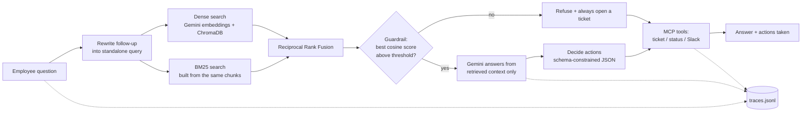

# IT Support Agent

[](https://github.com/Prathamesh0309/it-support-agent/actions/workflows/ci.yml)

An IT helpdesk assistant that answers from a knowledge base and takes action through MCP tools. The retrieval stack is written from scratch (chunking, BM25, rank fusion, a relevance guardrail), and every claim about quality is backed by an eval you can run.

## What's in it

| Area | What I built | Where |
| --- | --- | --- |
| **Custom retrieval** | BM25 from scratch, dense search over Gemini embeddings in ChromaDB, merged with Reciprocal Rank Fusion. Switch with `RETRIEVAL_MODE=dense\|bm25\|hybrid` | `rag/bm25.py`, `rag/fusion.py`, `phase1_rag.py` |
| **Ingestion** | Loaders for `.txt`, `.md` and `.pdf`. PDF extraction strips the running header, `Page X of N` footers and de-hyphenates, and re-joins sections split across pages | `rag/loaders.py` |
| **Chunking** | Three strategies behind one switch: heading-aware `structure` (default, adds a `Document > Section` header to each chunk), `section` and a fixed window, so the choice is measured | `rag/chunking.py` |
| **Guardrail** | If nothing retrieved is close enough (calibrated cosine threshold), the LLM is never called; the agent refuses and opens a ticket instead of guessing | `phase1_rag.is_relevant` |
| **Tool use** | FastMCP server with `create_ticket`, `check_ticket_status`, `notify_slack`; orchestrator uses schema-constrained JSON for decisions, with a deterministic override on top | `mcp_server.py`, `orchestrator.py` |
| **Evals** | Retrieval metrics (hit@k, MRR) separate from generation metrics (LLM-as-judge, different model from the generator); chunking and retrieval-mode ablations; regression gate in CI | `evals/`, `evaluate_rag.py` |
| **Observability** | One JSON trace per request with timed spans, token counts, retries, tool calls; a report CLI for latency percentiles, refusal and escalation rates | `observability.py`, `trace_report.py` |
| **Reliability** | Exponential backoff on 5xx and 429, safe fallbacks when the decision step fails | `config.generate` |
| **Tests / CI** | 68 offline tests (all model and tool calls mocked), GitHub Actions on every push, plus a manual live-eval workflow | `tests/`, `.github/workflows/` |

## Architecture



## Design decisions

**Chunking is measured, not assumed, and it follows the document's structure.** The knowledge base mixes formats: `---`-separated text, markdown with `##` headings, and PDFs with numbered headings. The `structure` strategy splits each on its own headings, packs sub-sections up to the size limit, and prefixes each chunk with a `Document > Section` header so a chunk still says where it came from. A plain 500-character window cuts procedures mid-step. On the offline BM25 benchmark below, both heading-aware strategies beat the fixed window by about 8 points of hit@3. `structure` only ties `section` on hit@3 and is slightly better on MRR, so I keep it as the default because it works on every format, not because the benchmark separates them. `section` has no markers to split on in a PDF, so there it is just a sliding window. The header should matter more for dense retrieval; that comparison needs a live run.

**Hybrid retrieval, fused by rank.** Embeddings handle paraphrase ("my computer is sluggish" finds "Laptop is slow or freezing"); BM25 handles exact tokens (`MTU`, `ext. 4357`, `CorpGuest`). Their scores sit on different scales, so I merge by rank with RRF instead of normalising and weighting.

**The refusal guardrail stays on dense cosine similarity.** BM25 scores have no absolute scale, so they can't say "this is off-topic". The threshold (`MIN_RELEVANCE = 0.62`) was set in the gap between in-scope and out-of-scope similarity on the original, smaller knowledge base. The knowledge base has since grown, so `python evaluate_rag.py --calibrate` sweeps the threshold on the dev split, picks the best balanced accuracy, and reports how that value holds up on the test split. It needs a Gemini key and I have not run it yet, so 0.62 is still the old value.

**The judge is a different model from the generator**, so the system isn't grading its own answers. Retrieval is scored with no LLM at all: a hit means the retrieved text contains the fact needed to answer, which also makes it fair across chunking strategies.

**Tracing is built in, and private by default.** Query text is recorded only as a length and a short hash unless `TRACE_CONTENT=1`. A write failure never breaks a request.

## Results

Offline benchmark: BM25 only, top-3, 117 answerable questions, no API key needed (`python -m evals.retrieval_eval --chunking all`). It also runs in CI as a regression gate. Follow-up questions are excluded because they need an LLM to rewrite the query.

| Chunking | Chunks | hit@3 | MRR | hit@3 (test split, n=38) |
| --- | --- | --- | --- | --- |
| **Structure-aware** (default) | 67 | 0.846 | **0.785** | 0.895 |
| Section (`---` only) | 56 | 0.846 | 0.766 | 0.895 |
| Fixed 500-char window | 70 | 0.761 | 0.677 | 0.868 |

By question type, `structure` scores direct 0.92, paraphrase 0.84, multi-fact 1.00, lexical gap 0.72 and typo 0.40. Lexical-gap and typo questions are where exact-match BM25 is weakest ("my computer is really sluggish" vs "Laptop is slow or freezing", "wen do i get paied"), and where dense search should help. Compare all three modes against your own index with:

```bash
python evaluate_rag.py --compare      # dense vs bm25 vs hybrid: hit@3, MRR, refusal behaviour
python evaluate_rag.py --calibrate    # tune MIN_RELEVANCE on dev, check it on test
python evaluate_rag.py                # full run with the LLM judge: faithfulness, answer relevancy
```

The live dense, hybrid and judge numbers are not in this table because they need a Gemini key; they have not been measured yet.

**The dataset.** 134 questions, split into `dev` (88) and `test` (46) by a hash of the id. Types: direct, paraphrase, lexical gap, typo, multi-fact (every fact must be retrieved), follow-up (needs conversation history), near-miss out-of-scope (right topic, not in the knowledge base) and plainly out-of-scope. Tune settings on `dev`, report on `test`.

**Limits, stated plainly:** the company is fictional. The 11 documents (4 policy PDFs generated by `tools/generate_policy_pdfs.py`, 1 markdown file, 6 text files; 67 chunks) and the questions were written by me, the same person, so the test split is held out from tuning but is not independent. At this size one question is about one point of hit@3. Treat the numbers as a regression signal, not a benchmark. The ticket and Slack backends are mocks.

## Observability

Every request writes one line to `traces/traces.jsonl`: total latency, a flat list of spans (`retrieve`, `llm.generate`, `embed`, `decide`, `tool.*`) with parent ids and durations, model name, prompt and output tokens, retry counts, and request-level flags (`answered_from_kb`, `escalated`).

```bash
python trace_report.py
```

reports request count, p50/p95 latency overall and per span, LLM calls per request, tokens per model, refusal rate, escalation rate and tool usage. Set `TRACING=0` to turn it off.

## Quick start

Requires Python 3.10+ and a Gemini API key.

```bash
git clone https://github.com/Prathamesh0309/it-support-agent
cd it-support-agent
python -m venv venv && source venv/bin/activate   # Windows: venv\Scripts\activate
pip install -r requirements.txt
echo "GEMINI_API_KEY=your_key_here" > .env

python phase1_ingest.py     # parse, chunk, embed and index data/ (txt, md, pdf)
python orchestrator.py      # the agent: retrieval + tool actions
```

| Setting | Default | Meaning |
| --- | --- | --- |
| `RETRIEVAL_MODE` | `hybrid` | `dense`, `bm25` or `hybrid` |
| `CHUNKING` | `structure` | `structure`, `section` or `fixed` (re-run `phase1_ingest.py` after changing) |
| `JUDGE_MODEL` | see `config.py` | Model used by the LLM judge |
| `TRACING` / `TRACE_FILE` / `TRACE_CONTENT` | `1` / `traces/traces.jsonl` / off | Tracing switch, location, and opt-in raw query text |

## Testing and evals

```bash
pip install -r requirements-dev.txt
pytest                                           # 68 offline tests, no API key
python -m evals.retrieval_eval --chunking all    # offline BM25 + chunking ablation
python -m evals.retrieval_eval --chunking all --split test   # held-out split only
python evaluate_rag.py --compare                 # live: dense vs bm25 vs hybrid
python evaluate_rag.py --calibrate               # live: recalibrate the refusal threshold
python evaluate_rag.py --min-hit-rate 0.85 --min-faithfulness 0.9   # live gate: exit 1 if below
```

The `live-eval` GitHub Actions workflow runs the live evaluation on demand; add a `GEMINI_API_KEY` repository secret first.

## Project structure

| Path | Purpose |
| --- | --- |
| `rag/` | Loaders (txt/md/pdf), chunking strategies, BM25, rank fusion. No API calls |
| `phase1_ingest.py` | Loads `data/` documents, chunks, embeds, indexes into ChromaDB |
| `phase1_rag.py` | Dense, BM25 and hybrid retrieval; the relevance guardrail; answer generation |
| `orchestrator.py` | Decides actions and calls MCP tools; one trace per request |
| `mcp_server.py` | MCP tool server (tickets persist to `tickets.json`) |
| `config.py` | Models, retrieval settings, retrying Gemini client |
| `observability.py`, `trace_report.py` | Tracing and the report CLI |
| `evals/` | Dataset (`dataset.jsonl`) and the offline retrieval evaluation |
| `evaluate_rag.py` | Live evaluation: retrieval modes, guardrail, LLM judge, gates |
| `tests/` | Offline unit tests |
| `data/` | Fictional company knowledge base: IT troubleshooting (txt), developer tools (md), and HR and IT policies (PDF) |
| `tools/` | `generate_policy_pdfs.py` regenerates the sample PDFs |

## What I'd do next

- Let the model choose tools itself through MCP function calling in a bounded loop, keeping the deterministic escalation rule as a guardrail around it
- Add a reranker, and a human-approval step before tickets are created
- Real Jira and Slack backends behind the same MCP interface
- Run the live evals and recalibrate the guardrail threshold, then add dense and hybrid results to the table
- Scanned-PDF support (OCR), and table-aware parsing for PDFs with tables
